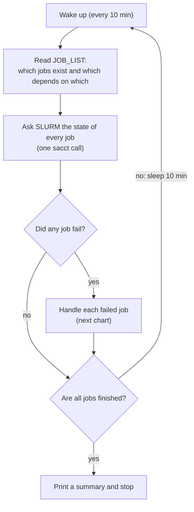
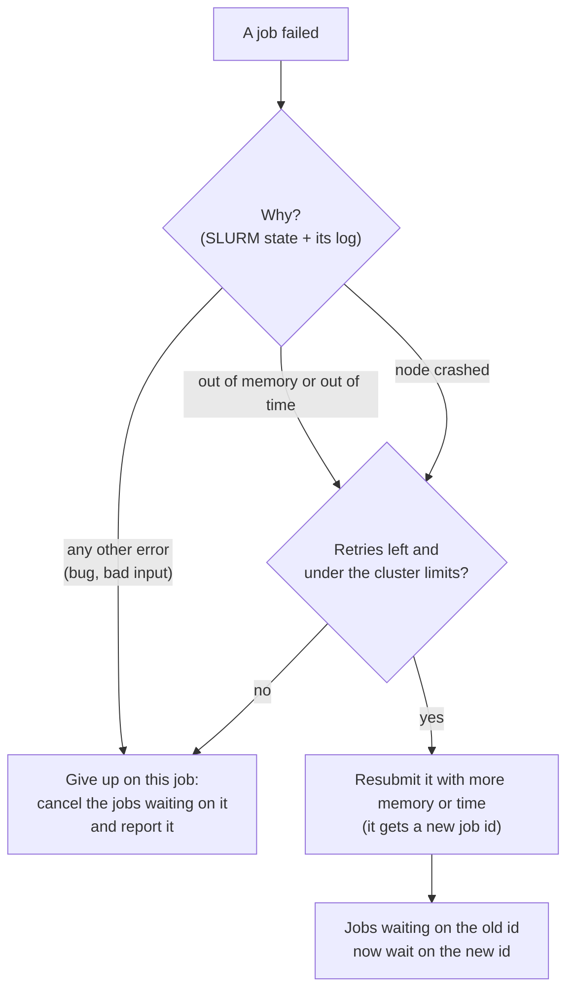

# Smarter restart: resource-neutral hashing and automatic resource retries

Status: **proposal, for team review**. Nothing is implemented yet.
Scope: SLURM (Alliance clusters), PBS (Abacus), and batch.

Revision 2: automatic retries now run through an external **monitor** that reconciles the job DAG, following a team member's proposal. The in-job retry from revision 1 is now under *Alternatives considered* (section 5).

## 1. Problems

1. **Resource failures need manual work.** When a job fails with `OUT_OF_MEMORY`, `TIMEOUT` or a Java heap error, the user has to read the log, edit an ini, run `genpipes` again and resubmit. Nothing retries automatically.
2. **Changing a resource restarts finished work.** Example: the user raises `threads` or `ram` for one failed sample. Every *done* job in that step, and every job downstream of it, runs again.

## 2. Root cause (current code)

- `Pipeline.create_jobs` (`core/pipeline.py`) names the done file `job_output/<step>/<job>.<md5(job.command_with_modules)>.mugqic.done`.
- The `cluster_cpu`, `cluster_mem` and `cluster_walltime` values are **not** in that hash. They only appear in `#SBATCH`/`#PBS` lines.
- The base inis copy resources into the command itself, so they end up in the hash:
  - `threads = %(cluster_cpu)s`
  - `ram = %(cluster_mem)s`, which becomes `-Xmx{ram}`
  - `options = -t %(cluster_cpu)s`
  - `java_other_options = -XX:ParallelGCThreads=2`
- In `bfx/` there are about 93 `threads` lookups, 154 `ram`, 94 `java_other_options` and 165 `tmp_dir`.
- `Job.is_up2date` returns `False` when any upstream job is scheduled. One changed hash therefore cascades to every child job.
- Raising `cluster_mem` alone does not fix a Java heap error. The heap limit is the `-Xmx` value written into the scientific `.sh`, and the job ends as `FAILED`, not `OUT_OF_MEMORY`.

**Consequence:** a retry, whether started by a monitor or by a user, cannot change memory or threads without changing the scientific `.sh`. With today's hashing, that also changes the job's `.done` path. So resource values must become runtime variables (part A) before automatic retries can work.

## 3. Design overview

| Part | What it does | Schedulers |
|---|---|---|
| A. Resource tokens | Resource values in commands become `${GP_RES_<section>__<option>}` variables. The hash sees only the variable name. | all |
| B. Attempt history in `JOB_LIST` | Each submission row also records its attempt number, the job id it replaces, and its resources. The last row for a job name is its current attempt. | all |
| C. Escalation at regeneration | Running `genpipes` again raises resources for the jobs whose last attempt failed for a resource reason. | all |
| D. Restart monitor | `genpipes tools monitor <job_list>` checks the jobs regularly. It resubmits the ones that failed for resource reasons and reconnects their descendants. | SLURM, then PBS (batch: a simple loop) |

### A. Resource tokens (resource-neutral hashing)

**Which values are resources.** This is configured in the ini. Defaults:

```ini
[DEFAULT]
resource_keys_cpu    = cluster_cpu, threads, *_threads, nthreads
resource_keys_mem    = cluster_mem, ram, *_ram, max_memory, max_records_in_ram
resource_keys_time   = cluster_walltime
resource_keys_opaque = tmp_dir   # not hashed, never scaled
# JVM flags treated as resources *inside* java_other_options (see below)
resource_jvm_flags   = -Xmx, -Xms, -XX:ParallelGCThreads, -XX:ConcGCThreads, -XX:ActiveProcessorCount
```

**`java_other_options` stays hashed.** What it contains depends on the tool behind it: GC tuning for one tool, `-D` properties that change behaviour for another. So the whole value is not treated as a resource. Only the JVM flags listed in `resource_jvm_flags` are turned into tokens, wherever they appear in it; everything else stays in the hash. In the worst case, a change that only affects speed (such as `-Dsamjdk.buffer_size`) still reruns the job, which is today's behaviour.

**Config layer.** In `core/config.py`:

- `Config.global_get` returns a `ResourceInt` or `ResourceStr` for resource keys. It keeps the real value in `.value`. When formatted (`str()`, f-string, `.format`) it renders as `${GP_RES_<section>__<option>}`.
- Python logic that compares or tests the value still sees the real value.
- Arithmetic (`threads - 1`) returns a plain `int`. That value falls back to today's behaviour (a literal value that is hashed). It is safe, only less smart.
- A custom `configparser.Interpolation` replaces `%(cluster_cpu)s`-style references *inside* free-form options with the token. So `options = -t %(cluster_cpu)s` is handled without editing the ini.
- `--sanity-check` warns when a known resource value appears as a literal in a command.

**Job layer.**

- `Job` collects the tokens its command references, from all sections, because `concat_jobs` can mix several.
- It stores them in `job.resources`, together with the scheduler resources (cpu, mem, walltime, gpu, node).
- The scheduler reads `job.resources` instead of calling `global_conf` again. This is also what makes per-job escalation possible.

**Generated script.**

- The submission file (or the batch block) exports the values:

  ```bash
  export GP_ATTEMPT=1
  export GP_RES_bwa_mem2__threads=16
  export GP_RES_picard_mark_duplicates__ram=12G
  ```

- The scientific `.sh` starts with defaults, so a user can still run it by hand:

  ```bash
  : "${GP_RES_picard_mark_duplicates__ram:=12G}"
  ```

- The scientific file is written with a quoted heredoc, so `${...}` stays literal at generation time.
- `srun` exports the environment by default, singularity inherits it, and docker already uses `--env-file`.

**Hash.**

- The hash is computed as `md5(command_with_modules)`, where the command contains token names. Changing resource *values* no longer changes the done file name.
- Per-step opt-out: in a step's section, `hash_resources = threads` (or `true`) adds those values back into the hash. This is for tools whose output depends on the thread count.

**Migration (required).** Without this step, upgrading GenPipes in the middle of a project would rerun everything.

1. If the new-style `.done` is missing, compute the legacy hash: the tokens rendered to literal values, which is exactly today's string.
2. If a legacy `.done` exists, accept it and create the new `.done`, keeping its mtime.

**`.done` contents.** Today the file is empty (`touch`). It becomes a small JSON: hash, resource values, attempt, scheduler job id, GenPipes version, end time. Up-to-date checks still only test that it exists, so old files stay valid.

### B. Attempt history in `JOB_LIST`

`JOB_LIST` (`job_output/<Pipeline>[.<protocol>].job_list.<timestamp>`) already has one row per submitted job: `id, name, dependency ids, .o path`. It holds everything needed to rebuild the DAG, so it is the source of truth. **No SQLite**: its locking is unreliable on Lustre/NFS.

New columns are appended; existing readers use columns 0–3 by position:

```
id  name  deps  o_path  attempt  replaces_id  failure_class  resources_json
```

- Initial submission: `attempt=1`, empty `replaces_id`.
- Each restart **appends** a row. The last row for a job name is its current attempt.
- `cancel_running_pipeline` reads only column 1, so it also cancels the retries.
- `failure_class` is filled on the row of the *failed* attempt when it is resubmitted (the file is append-only, so it is written on the new row as `replaces_id` → class).

A shared, unit-tested `core/failure.py` gives the **failure class**:

- **SLURM:** `sacct` state (`OUT_OF_MEMORY`, `TIMEOUT`, `NODE_FAIL`, `PREEMPTED`).
- **PBS:** the scheduler's messages (`job killed: mem ... exceeded limit`, `walltime ... exceeded limit`) plus the exit code.
- **Batch:** exit code `137`.
- **All schedulers:** `retry_fail_patterns` found in the job's `.o`, e.g. `java.lang.OutOfMemoryError`, `std::bad_alloc`, `Cannot allocate memory`. This follows the existing `fail_on_pattern` mechanism.

Classes: `MEMORY`, `TIME` (escalate), `NODE` (rerun as is), `OTHER` (never retried).

### C. Escalation at regeneration ("smart regenerate")

- `create_jobs` reads every `job_list.*` file in `job_output/` to rebuild each job's attempt count and last failure.
- For a job that is **not** up to date whose last attempt failed with `MEMORY` or `TIME`, it scales **only that job's** `job.resources`, within the limits, and logs it. For example: `bwa_mem2.S1 failed OUT_OF_MEMORY (attempt 2/3): cluster_mem 32G -> 48G, ram 30G -> 45G`.
- Because of A, raising `ram` for `S1` does not change the hash of `S2` to `Sn`.
- New flags:
  - `--no-escalate` turns this off.
  - `--reset-attempts` ignores the earlier history.

Escalation policy, shared by C and D. It uses normal ini lookup, so it is per step with `[DEFAULT]` as fallback:

```ini
[DEFAULT]
retry_max_attempts    = 3          # including the first; 1 disables retries
retry_on              = MEMORY,TIME,NODE
retry_mem_factor      = 1.5        # cluster_mem and every mem-class token
retry_walltime_factor = 2
retry_cpu_factor      = 1          # raising CPUs is opt-in per step
retry_fail_patterns   = java.lang.OutOfMemoryError,std::bad_alloc,Cannot allocate memory
monitor_interval      = 10m        # grows to monitor_max_interval when nothing changes
monitor_max_interval  = 30m
# caps come from the cluster inis (common_ini/rorqual.ini, ...)
retry_max_mem         = 750G
retry_max_walltime    = 7-00:00:00
retry_max_cpu         = 192
```

Rules:

- Units are parsed (`M`/`G`, and `per cpu` memory is scaled per CPU).
- Memory-class tokens keep their ratio to `cluster_mem`, so Java `-Xmx` grows with the allocation.
- A job already at its cap is not retried, and the message says so.

### D. Restart monitor

`genpipes tools monitor <job_list>` checks the jobs regularly and fixes failures it can retry.

**One reconciliation cycle:**

1. **Lock.** Take or renew `job_output/.monitor.lock`, which holds host, pid and a heartbeat time. Exit if another monitor's heartbeat is newer than 3 × `monitor_interval`. Don't rely on `flock`: it is unreliable on Lustre.
2. **Rebuild the DAG** from `JOB_LIST`, taking the latest row per job name. Chunked submissions also write rows to `chunk_N.out`, so read those as well.
3. **Query the scheduler once.**
   - SLURM: `sacct -X -P -j <all current ids> --format=JobID,State,ExitCode,...`.
   - PBS: `qstat -f -x` (or `tracejob`).
4. **Classify** each failed job with `core/failure.py`, using its state and its `.o`.
5. **For each job to retry** (class in `retry_on`, attempts left, under the caps):
   1. Write `<job>_<ts>.restart_N.submit` with the scaled `#SBATCH` lines and `GP_RES_*` values. The scientific `.sh` is reused unchanged (it needs part A).
   2. Run `sbatch`. No dependency is needed: the job ran, so its parents had already completed.
   3. **Append its `JOB_LIST` row immediately**, so a monitor that crashes mid-cycle does not submit it twice. The submission also sets `--comment=gp:<job>:<attempt>`, so a restarted monitor can find attempts it submitted but never recorded.
6. **Reconnect the descendants**, in DAG order.
   - A *running* job never needs reconnecting: its `afterok` dependencies were met before it started. Only *pending* descendants are affected.
   - **Still pending:** `scontrol update JobId=<id> Dependency=afterok:<current ids>`. This keeps their queue priority.
   - **Already cancelled:** resubmit them from their existing submission file with the current ids, and append rows. This is the fallback for jobs submitted without monitoring, or before it was enabled.
   - **Keeping children pending.** Rorqual, fir and narval all set `kill_invalid_depend`, so by default Slurm cancels the children of a failed job immediately. With `--monitor`, every job that has dependencies is submitted with `#SBATCH --kill-on-invalid-dep=no`, which overrides the cluster setting for that job (confirmed in the `sbatch` man page on all three). The children stay pending (`DependencyNeverSatisfied`) until the monitor reconnects them, and they keep their queue priority. Without `--monitor`, the cluster default is unchanged.
   - Because of that, a monitor that stops for good would leave children pending for ever. The final-failure path cancels them. `log_report` warns about pending `DependencyNeverSatisfied` jobs. `genpipes tools monitor --cleanup <job_list>` cancels them by hand.
   - **Throttle scheduler requests.** Rorqual limits each user's requests to the scheduler: bursts of 50, then about 10 per second; past that, commands are told to wait a second. The monitor spaces its `sbatch` and `scontrol update` calls (at most 5 per second).
   - **Respect the submit limit.** Rorqual allows 1000 submitted jobs per account. Before resubmitting, the monitor counts the user's jobs with `squeue`. If there isn't room, it waits for the next check instead of failing.
7. **Catch late submissions.** A pending job whose dependency still names an id that has been replaced is fixed in the same pass. This covers children submitted after the retry, for example by `chunk_and_submit_genpipes`. Running a cycle twice does no harm.
8. **Final failures** (class `OTHER`, attempts used up, or at the cap): cancel the pending descendants and record the reason.
9. **Finish.** Stop when every job's latest row is `COMPLETED` or a final failure. Print a summary in the `log_report` format.

**In short**, the monitor does two things.

1. A check every 10 minutes (`monitor_interval`):



2. The decision for each failed job:



**Example.** The chain is `trim.S1 → align.S1 → markdup.S1 → call.S1`, and `markdup.S1` (job 1003) runs out of memory at 16G.

| Check | What SLURM reports | What the monitor does |
|---|---|---|
| 10:00 | `1003 OUT_OF_MEMORY`; `call.S1` waiting on 1003 | Resubmits `markdup.S1` with 24G as job 1005 and adds a `JOB_LIST` row (attempt 2, replaces 1003). Changes `call.S1` to wait on 1005. |
| 10:10 | 1005 running, `call.S1` waiting | Nothing failed, so it sleeps. |
| Later | All jobs completed | Prints a summary and stops. |

**Where the monitor runs.** Alliance does not allow long-running processes on login nodes. `sbatch` works from inside jobs on Alliance clusters (confirmed by the team). Options, in order of preference:

1. **One long, small monitor job.** 1 CPU, about 1 GB, `--time=24:00:00`. It runs the check loop itself. Shortly before its walltime, if the pipeline isn't finished, it submits its replacement and exits. The GenPipes script submits the first one at the end, when monitoring is enabled.
   - Narval asks for jobs of at least one hour and at most 1000 jobs per user (from a search snippet of the Narval wiki page; the wiki blocks automated reading). One long job fits that. A 5-minute job resubmitted every 10 minutes would not, and each run would also wait in the queue, so the real interval would be much longer than 10 minutes.
   - Cost: about 24 core-hours per day per pipeline, mostly idle.
   - Later refinement: **one monitor per user** watching every active `JOB_LIST` (a list of active pipelines under `$HOME/.genpipes/`). This saves core-hours and scheduler load when someone runs several pipelines.
2. **`scrontab`**, Slurm's own scheduler-side cron. **Not available on rorqual, fir or narval**: `scrontab -l` returns "scrontab is disabled on this cluster". Keep it only as an option for other sites.
3. **In the foreground**, for a local run or a user's own server.

**Polling frequency.** The goal is to keep scheduler load small:

- **One state query per check:** `sacct -X -P -j <ids> --format=JobID,State,ExitCode,...` for every current id at once. `sacct` reads Slurm's accounting database, not the main scheduler process (`slurmctld`), which is the one that slows down for everyone when it's flooded.
- **`squeue` and `scontrol` only when a job failed**, to find and reconnect its pending descendants.
- **Adaptive interval:** 10 min by default. It grows to 30 min after 3 checks in a row with no change, and goes back to 10 min after any change. Values below 2 min are refused.
- **Comparison:** the nf-core configuration for Alliance clusters has Nextflow poll every 60 s (`pollInterval = '60 sec'`). This design is 10–30 times lighter.
- **Latency:** a few minutes is short compared with how long a job runs before it hits a memory or walltime limit, and with the time a resubmitted job waits in the queue.

On PBS/Abacus, the equivalent options have to be checked.

**Batch mode** has no monitor. The generated script wraps each job in a loop that retries a `MEMORY` failure (exit 137 or a matching pattern), using scaled memory-class `GP_RES_*` values.

**Files per attempt.** This answers the open question in the proposal.

| File | Retry | Why |
|---|---|---|
| Scientific `.sh` | **Reused unchanged** | Resources are `GP_RES_*` variables (part A), so the command, its hash and `JOB_DONE` stay the same. |
| Submission file | **New:** `<job>_<ts>.restart_N.submit` | The `#SBATCH` resources and `GP_RES_*` values differ. |
| `.o` | **New:** `<job>_<ts>.restart_N.o` | SLURM overwrites the output file unless you pass `--open-mode=append`. One file with several prologue/epilogue blocks would confuse `log_report`, and the evidence of the earlier failure would be mixed in. `JOB_LIST` links each attempt to its `.o`. |

## 4. How the parts work together

- **The user does nothing.** The monitor (D) retries resource failures while the pipeline runs.
- **The monitor gives up or isn't used.** The user fixes the cause or just runs `genpipes` again. Escalation at regeneration (C) reads the `JOB_LIST` history, so a job that already failed twice for memory starts with more memory.
- **The user edits resources by hand.** Thanks to the resource variables (A), done jobs and their descendants are not rerun.

## 5. Alternatives considered

| Option | Why not chosen |
|---|---|
| In-job retry from the `EXIT` trap (revision 1) | Can't run when the job is SIGKILLed at walltime or killed outright by PBS at its memory limit. Needs `sbatch` from every job. Children submitted after the retry still point at the old id, which needs an extra id-map file. The logic would be split between bash and Python. |
| SQLite for the DAG | `JOB_LIST` already has the DAG, and SQLite locking is unreliable on Lustre/NFS. |
| Appending restarts to the GenPipes `.sh` | Running the script again would resubmit them. `JOB_LIST` is the right place. |
| A long-running daemon on the login node | Not allowed by Alliance policy. Replaced by a monitor job. |
| A short monitor job resubmitted every 10 min | Conflicts with Narval's one-hour minimum, and each run waits in the queue, so checks would be irregular. Replaced by one long monitor job. |
| `scontrol requeue` with the job held, then update resources | It would keep the same job id. But users cannot increase a pending job's `TimeLimit`, so TIMEOUT can't be fixed this way. Requeue is also disabled on rorqual, fir and narval (`JobRequeue = 0`). |
| A "sentinel" job per job (`afternotok`) | Doubles the job count, and `cluster_max_jobs` is 3000 on rorqual. |
| Hash normalization by search-and-replace of values | Fragile: a `"8"` can appear anywhere in a command. Tokens are exact. |
| Explicit `global_conf.resource(...)` API at every call site | Clearer, but means editing about 300 call sites. Tokens give the same result through the config layer. |

## 6. Phases

| Phase | Content | Depends on | Visible behaviour change |
|---|---|---|---|
| 0. Foundations | `job.resources`; the scheduler reads from it; `core/failure.py`; new `JOB_LIST` columns; JSON in `.done`; pytest scaffold; remove the `daemon` choice from `-j` | – | `-j daemon` no longer offered |
| 1. Resource-neutral hashing | tokens, custom interpolation, exports, legacy `.done` migration, `hash_resources` opt-out, sanity-check warnings | 0 | resource changes stop invalidating done jobs |
| 2. Escalation at regeneration | part C, reading the `JOB_LIST` history (SLURM, PBS, batch) | 0 (1 needed for in-command values such as `-Xmx`) | rerunning `genpipes` raises resources for failed jobs |
| 3. Restart monitor | `genpipes tools monitor`: reconciliation, lock, adaptive polling, long monitor job that renews itself. SLURM first, then PBS; batch gets its retry loop | 1, 2 | failed jobs retry without user action; opt-in (`--monitor`) until CIT validates it |
| 4. Reporting | `log_report` groups attempts by job name; project tracking records attempts inside the run's single operation; docs and CHANGELOG | 3 | – |

Phase 2 can ship without phase 1 for scheduler-level resources (`cluster_mem`, `cluster_walltime`). Java heap failures need phase 1.

## 7. Testing

- **Unit tests (new pytest suite):**
  - The hash does not change when `threads`, `ram` or `tmp_dir` change, but does change when a scientific option changes.
  - `hash_resources` opt-out.
  - Legacy `.done` migration.
  - Escalation math (units, `per cpu`, caps).
  - Failure classifier on recorded `sacct` output, PBS logs and Java logs.
- **Monitor tests with a fake scheduler** (recorded `JOB_LIST` + `sacct` output):
  - Which jobs are retried, reconnected, resubmitted or cancelled.
  - DAG order.
  - Crash halfway through a cycle, then restart: no job is submitted twice.
  - A late child that still names a replaced id.
  - Two monitors started at once: the lock lets only one act.
- **Script snapshots:** generate the `rnaseq_light`, `dnaseq` and `chipseq` scripts before and after the change. The only differences should be tokens and exports.
- **On a cluster (CIT, `GENPIPES_CIT`):**
  - A test step that allocates more memory than requested and sleeps past its walltime, to confirm escalation, reconnection and cancellation.
  - A chunked submission (`chunk_and_submit_genpipes`) where the failure happens before the children are submitted.

## 8. Open questions and things to verify

1. **Hosting the monitor on Alliance clusters.** `sbatch` from inside a job is confirmed, and `scrontab` is disabled on rorqual, fir and narval (see 10).
   - Repeat the checks on nibi (commands in 10).
   - Is a 1-CPU, 24 h, mostly idle monitor job acceptable? Ask Alliance support whether there is a preferred pattern for workflow managers.
   - The polling proposal (one `sacct` per check, 10–30 min adaptive) could be confirmed with Alliance support.
2. **Thread-dependent outputs.** Which tools give different output with a different thread count? Those steps get `hash_resources = threads` by default.
3. **PBS/Abacus.**
   - How would a monitor run there?
   - What happens to `afterok` children when the parent fails under Torque?
   - Does `qalter -W depend=` work for reconnecting them?
4. **Defaults.** Default `retry_max_attempts`, factors, `monitor_interval`, and per-cluster caps.
5. **JVM resource flags.** Is `resource_jvm_flags` (`-Xmx`, `-Xms`, `-XX:ParallelGCThreads`, `-XX:ConcGCThreads`, `-XX:ActiveProcessorCount`) the right list? Are there tools where one of them changes the output?

## 9. Decisions

1. **Project tracking: one operation per run, not per attempt.** A GenPipes run stays a single operation. A job's retries are recorded as attempts of that job inside the operation (attempt number, failure class, resources, scheduler id), and the job's final state is its last attempt.
2. **`java_other_options` stays in the hash.** Its content depends on the tool, so only known JVM resource flags inside it become tokens (see part A). The flag list is open question 5.
3. **Remove `daemon` from the `-j` choices.** It is a leftover: a `DaemonScheduler` drafted in 2014 that printed the pipeline as JSON for an external runner. It was dropped from the options in 2015 and the class was deleted in 2024, but the choice stayed in `core/pipeline.py`, so `-j daemon` currently fails. This can be done in phase 0.

## 10. Cluster facts (checked 2026-10-26)

| Setting | rorqual | fir | narval | Effect on the design |
|---|---|---|---|---|
| `scrontab` | disabled | disabled | disabled | The monitor runs as one long job (part D). |
| `crontab` | not allowed | allowed (on a login node) | not allowed | Not used. A login-node cron is tied to one login node, and fir is the only cluster that allows it. |
| `DependencyParameters` | `kill_invalid_depend` | `kill_invalid_depend` | `kill_invalid_depend` | Children of a failed job are cancelled immediately unless they were submitted with `--kill-on-invalid-dep=no` (available on all three). GenPipes sets that flag when `--monitor` is on. |
| `JobRequeue` | `0` | `0` | `0` | The requeue alternative is not possible. |
| `MinJobAge` | `300 sec` | `30 sec` | `300 sec` | Finished jobs disappear from `squeue`/`scontrol` quickly. Job state comes from `sacct`, and rebuilt dependencies never name jobs that already completed. |
| `KillWait` | `60 sec` | `30 sec` | `60 sec` | – |
| Request rate limit (`rl_*`) | bucket 50, refill 10/s | bucket 50, refill 10/s | none | Per-user scheduler request limit on rorqual and fir: bursts of 50, then about 10 per second. The monitor throttles itself the same way everywhere. The GenPipes submission script's `sleep 0.1` between jobs is already close to this limit. |
| Max submitted jobs per user | `1000` per account | none in accounts or QOS | `1000` per account | The monitor checks for room before resubmitting where a limit exists. |
| Longest partition | – | 28 days (default 1 h) | 7 days | A 24 h monitor job fits. |
| Slurm version | `25.11.8` | `26.05.4` | `25.11.8` | – |

Nibi is still to check:

```bash
scrontab -l
scontrol show config | grep -Ei "^(DependencyParameters|JobRequeue|MinJobAge|KillWait|SlurmctldParameters|SLURM_VERSION)"
sacctmgr -nP show assoc user=$USER format=account,maxjobs,maxsubmit
```
