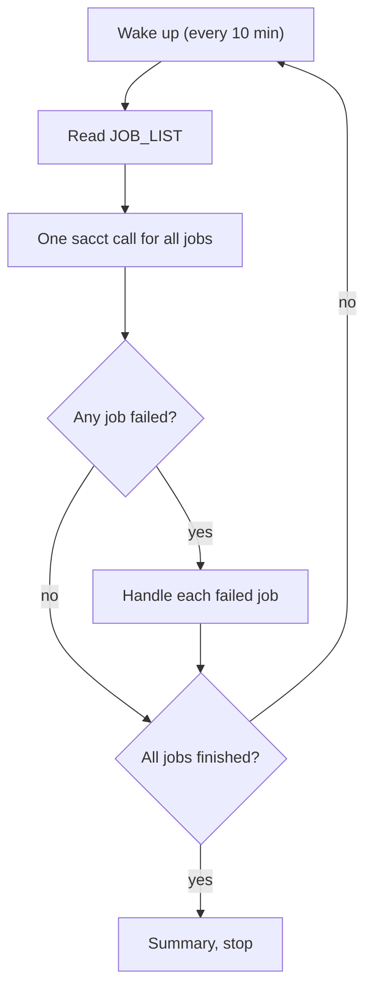
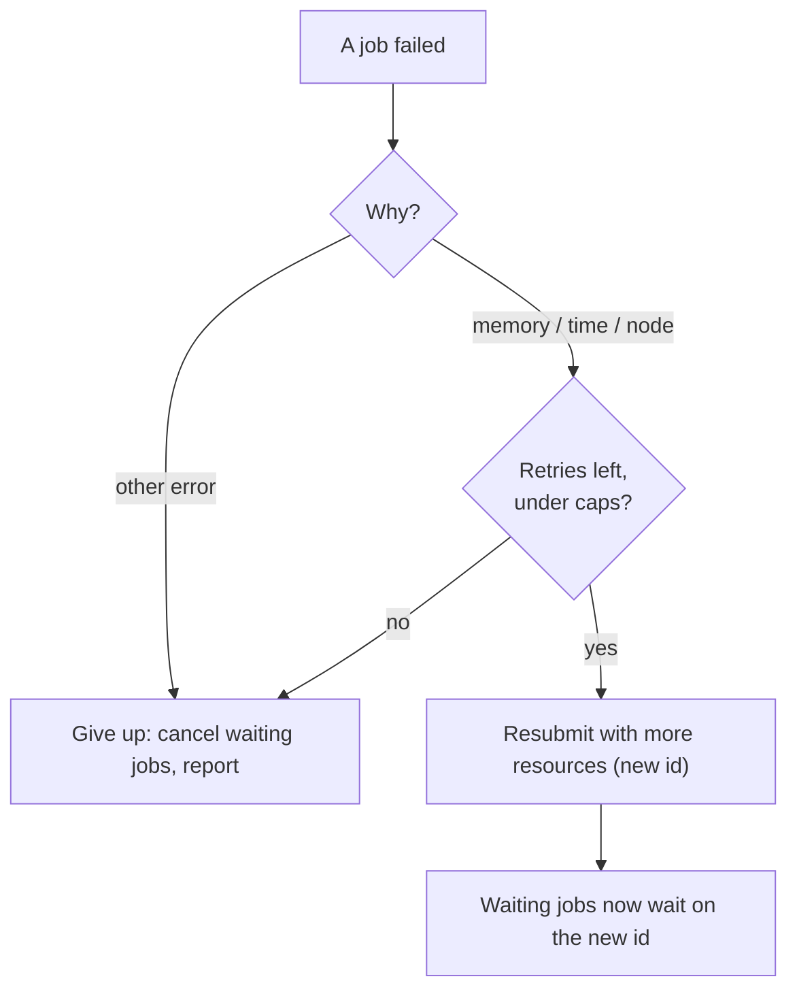

# Smart restart (GenPipes 7.0)

Status: proposal for team review. Major release, so breaking changes are allowed.

## Summary

- **Problem 1:** jobs that fail for memory or walltime need a manual fix and resubmission.
- **Problem 2:** changing `threads`/`ram` reruns finished jobs and everything downstream.
- **Fix:**
  - resource values become runtime variables, so they are no longer in the job hash;
  - failed jobs get more resources when `genpipes` is rerun;
  - an opt-in Slurm monitor retries them automatically.
- **Key decisions:**
  - hashes break once in 7.0, with a migration tool;
  - an explicit resource API in the code;
  - `JOB_LIST` is the source of truth;
  - PBS gets everything except the monitor;
  - the safety net comes first.

## Cause

- The `.done` name is `md5(command_with_modules)` (`core/pipeline.py`).
- `cluster_*` values are not hashed, but the inis copy them into commands:
  - `threads = %(cluster_cpu)s`
  - `ram = %(cluster_mem)s`, which becomes `-Xmx`
  - `options = -t %(cluster_cpu)s`
- So a resource change changes the hash, the job reruns, and `is_up2date` cascades to every child job.
- A Java heap error can't be fixed through `cluster_mem` alone: `-Xmx` is written into the command, and the job ends as `FAILED`, not `OUT_OF_MEMORY`.

## Design

| Part | What | SLURM | PBS | Batch |
|---|---|---|---|---|
| A. Explicit resources | Resource values in commands become `${GP_RES_<section>__<option>}` variables; the hash sees only the names | yes | yes | yes |
| B. Attempt history | `JOB_LIST` gets a header and attempt columns | yes | yes | yes |
| C. Escalation at regeneration | Rerunning `genpipes` raises resources for jobs that failed for memory or time | yes | yes | yes |
| D. Restart monitor | Resubmits those failures automatically and reconnects the waiting jobs | opt-in | - | retry loop |

### A. Explicit resources

```python
ram = global_conf.resource(section, "ram")         # "${GP_RES_<section>__ram}", a plain str
ram_g = global_conf.resource_value(section, "ram") # "16G", only for Python logic
command = f"java -Xmx{ram} -jar picard.jar MarkDuplicates ..."
```

- `resource()` returns the variable as plain text, so every way of building a string gives the same result. A `str`/`int` subclass doesn't work: `join`, `+` and `%d` use the real value.
- All ~300 call sites are converted.
- Classes:
  - **cpu:** `cluster_cpu`, `threads`
  - **mem:** `cluster_mem`, `ram`, `max_records_in_ram`
  - **time:** `cluster_walltime`
  - **opaque:** `tmp_dir` (not hashed, never scaled)
- `java_other_options` stays hashed, except the JVM resource flags inside it: `-Xmx`, `-Xms`, `-XX:ParallelGCThreads`, `-XX:ConcGCThreads`, `-XX:ActiveProcessorCount`.
- **ini cleanup:** `options = -t %(cluster_cpu)s` becomes a `threads` key. `--sanity-check` reports an error when an option copies in a resource value.
- `job.resources` holds the values, and the scheduler reads them from there.
  - The submission file exports them through the heredoc path, not `echo "..."`.
  - The scientific `.sh` gets `: "${VAR:=value}"` defaults, so it can be run by hand.
- **Per-step opt-in:** `hash_resources = threads` keeps thread counts in the hash, for tools whose output depends on them.
- `.done` becomes JSON (hash, resources, attempt, job id, version). Up-to-date checks still only test that it exists.
- **Migration:** `genpipes tools migrate_done <output_dir> [--dry-run] [--keep-legacy]` renames 6.x `.done` files to their 7.0 names.
  - Jobs whose command changed beyond resource values are reported and will rerun.
  - Going back to 6.x needs `--keep-legacy`.

### B. Attempt history

```
job_id  job_name  dependencies  output  attempt  replaces_id  failure_class  resources
```

- Each restart appends a row. The last row for a job name is its current attempt.
- With the header, readers use column names. `log_report`, `cancel_running_pipeline` and `chunk_genpipes.sh` are updated.
- Failure classes come from `core/failure.py`, a pure function tested on fixtures:
  - **SLURM:** `sacct` state.
  - **PBS:** exit code plus Torque messages, from real Abacus logs.
  - **Batch:** exit 137.
  - **All:** `retry_fail_patterns` in the log, e.g. `java.lang.OutOfMemoryError`.

  Classes: `MEMORY`/`TIME` (escalate), `NODE` (rerun as is), `OTHER` (never retried).

### C. Escalation at regeneration

```
bwa_mem2.S1 failed OUT_OF_MEMORY (attempt 2/3): cluster_mem 32G -> 48G, ram 30G -> 45G
```

- Only the failed job's resources change. Its `.sh` and hash don't, so other samples are not affected.
- Flags: `--no-escalate`, `--reset-attempts`.
- **Duplicate guard:** jobs whose latest attempt is still pending or running are skipped (`--force` overrides).

```ini
[DEFAULT]
retry_max_attempts    = 3          # including the first; 1 disables
retry_on              = MEMORY,TIME,NODE
retry_mem_factor      = 1.5        # also scales ram/-Xmx
retry_walltime_factor = 2
retry_cpu_factor      = 1
retry_fail_patterns   = java.lang.OutOfMemoryError,std::bad_alloc,Cannot allocate memory
monitor_interval      = 10m
monitor_max_interval  = 30m
retry_max_mem         = 750G       # caps per cluster in common_ini/*.ini
retry_max_walltime    = 7-00:00:00
retry_max_cpu         = 192
```

### D. Restart monitor (Slurm, `--monitor`)

`genpipes tools monitor <job_list>` is a pure `reconcile(dag, states, history, policy) -> actions` plus a Slurm adapter with four operations: query, submit, update dependencies, cancel.





**Example.** `markdup.S1` (job 1003) runs out of memory at 16G. At the next check the monitor:
1. resubmits it with 24G as job 1005;
2. appends a `JOB_LIST` row (attempt 2, replaces 1003);
3. points `call.S1` at 1005.

**Rules.**

- **Lock:** one per `JOB_LIST`, created atomically and kept alive with a heartbeat. No `flock`, which is unreliable on Lustre.
- **No double submission:** the `JOB_LIST` row is written right after `sbatch`, and `--comment=gp:<job>:<attempt>` lets a restarted monitor find attempts it already submitted.
- **Waiting jobs:**
  - With `--monitor`, jobs that have dependencies are submitted with `--kill-on-invalid-dep=no`. Every checked cluster sets `kill_invalid_depend`, which would otherwise cancel them as soon as their parent fails.
  - Pending ones are reconnected with `scontrol update Dependency=`, so they keep their queue position. Cancelled ones are resubmitted.
  - On a final failure the waiting jobs are cancelled, `log_report` warns about any still stuck, and `monitor --cleanup` cancels them by hand.
- **Late submissions:** a job submitted later with an old id is fixed at the next check.
- **Limits:** at most 5 scheduler calls per second, and a check that there's room under the 1000-job limit.
- **Files per attempt:** a new `restart_N.submit` and `restart_N.o`; the scientific `.sh` is reused.
- **Hosting:** one 1-CPU, about 1 GB, 24 h job that runs the loop and resubmits itself until the pipeline is done. `scrontab` is disabled and login nodes are off-limits. Cost: about 24 core-hours per day per pipeline; one monitor per user is a later refinement.
- **Polling:** one `sacct` per check, every 10 min, growing to 30 min when nothing changes. For comparison, Nextflow's Alliance config polls every 60 s.

## Phases

| Phase | Content |
|---|---|
| 0. Safety net | Snapshot harness: pytest generates each pipeline from `cit.ini` and records every job's command and hash. Failure classifier with fixtures. `job.resources`. Remove `-j daemon`. |
| 1. Explicit resources | API and call-site conversion, ini cleanup, exports, `hash_resources`, JSON `.done`, `JOB_LIST` header, `migrate_done`. The snapshot diff must show only values replaced by variables. |
| 2. Escalation at regeneration | Part C and the duplicate guard, on all schedulers. |
| 3. Restart monitor | `reconcile()`, Slurm adapter, lock, monitor job, batch retry loop. Opt-in until CIT validates it. |
| 4. Reporting | Attempts in `log_report` and project tracking (one operation per run). Default resources suggested from recorded usage. |

**Tests:**
- the snapshot harness;
- unit tests for hashing, migration, escalation math and the classifier;
- `reconcile()` against a fake scheduler: crash mid-check, late children, two monitors, two pipelines in one `job_output/`, the job limit;
- CIT runs on a cluster that go over their memory and walltime on purpose.

## PBS (Abacus)

PBS gets parts A, B, C and the duplicate guard. It does **not** get the monitor: that would need a PBS adapter, a way to host the monitor and Abacus IT's involvement, all thrown away after a move to Slurm. `--monitor` on PBS stops with a clear message.

**Features that need Slurm (the case for migrating Abacus):**
1. Automatic retries. On Abacus, the user still has to rerun `genpipes`.
2. Reliable failure detection: Slurm job states, versus parsing PBS logs.
3. Accurate usage data. The PBS epilogue estimates requested memory from the CPU count (x5G, or x15G on `lm`) and records no average memory or disk I/O, so right-sizing is unreliable.
4. Epilogue changes without IT. `#PBS -T GenPipes` needs Abacus IT to redeploy every change.
5. Dependency control: keeping waiting jobs pending and reconnecting them to a new job.
6. One code path instead of two to maintain and test.

## Open questions

1. Alliance support: is a mostly idle 24 h monitor job acceptable, and is one `sacct` every 10-30 min fine?
2. Which tools' output depends on the thread count? Those steps get `hash_resources = threads`.
3. Is the JVM resource flag list right?
4. Defaults: attempts, factors, intervals, caps per cluster.
5. Abacus `.o` files from jobs killed for memory and for walltime, for the PBS classifier.
6. Check nibi.

## Appendix: cluster facts (2026-10-26)

| | rorqual | fir | narval |
|---|---|---|---|
| `scrontab` | disabled | disabled | disabled |
| `kill_invalid_depend` | yes | yes | yes |
| `JobRequeue` | 0 | 0 | 0 |
| `MinJobAge` | 300 s | 30 s | 300 s |
| Request rate limit | 50 burst, 10/s | 50 burst, 10/s | none |
| Max submitted jobs | 1000 | none found | 1000 |
| Slurm | 25.11.8 | 26.05.4 | 25.11.8 |

Check another cluster with:

```bash
scrontab -l; scontrol show config | grep -Ei "^(DependencyParameters|JobRequeue|MinJobAge|SlurmctldParameters|SLURM_VERSION)"
```

## Appendix: council review (2026-10-27)

- **Contrarian:** led to the explicit API, which replaces the subclasses. Also to `--keep-legacy`, the duplicate guard and the per-`JOB_LIST` lock.
- **First Principles:** led to doing the hashing fix first, and to keeping the monitor last and opt-in.
- **Executor:** led to the snapshot harness first and the heredoc quoting. Its two claims about breaking existing readers were checked and found wrong.
- **Expansionist:** led to `reconcile()` as a pure function, and right-sizing from usage.
